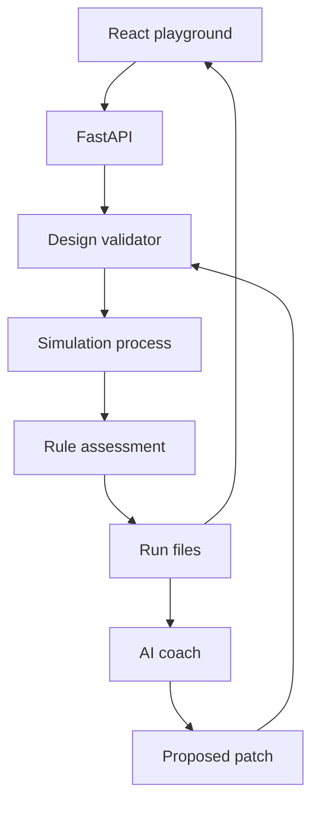

# Technical requirements and architecture

AI System Design Simulator · v0.1 · 26 September 2026

## 1. Chosen architecture

| Layer | Choice | Responsibility |
|---|---|---|
| Frontend | React, TypeScript, Vite, React Flow | Canvas, configuration forms, replay, results and comparisons |
| Styling/motion | CSS variables, CSS/SVG transforms; small motion library only if needed | Consistent visual states and smooth playback |
| API | Python, FastAPI, Pydantic | Validation, run management, persistence, AI provider access |
| Simulation | SimPy with project-owned component models | Virtual time, events, limited resources and request execution |
| Numerical work | Standard Python plus NumPy where useful | Seeded sampling, exact bounded-run percentile calculations |
| Storage | Versioned JSON and compressed JSONL files | Designs, challenges, runs, event summaries and evidence |
| AI | One configured provider adapter | Structured review and bounded design-patch suggestions |
| Tests | Pytest; frontend test runner; Playwright | Numerical fixtures, contracts, user journeys and motion checks |

Pin dependency versions when implementing and commit lockfiles. This specification does not require a particular latest release. No database, account system, Docker, MCP server, or agent framework is required for v0.1.

## 2. Module boundaries

- `frontend/`: app shell, challenge library, canvas, inspector, playback, results, comparisons; shared typed API client.
- `backend/api/`: endpoint schemas and handlers; never numerical simulation code.
- `backend/simulation/`: event environment, request lifecycle, profiles, components, routes, network, sampling.
- `backend/assessment/`: metric definitions, requirement checks, candidate ranking.
- `backend/coach/`: provider adapter, evidence selection, structured review validation and patch validation.
- `backend/storage/`: atomic file writes, manifests, immutable revisions, run lookup.
- `content/challenges/`: authored/versioned definitions and fixture references.
- `tests/`: analytical fixtures, workload cases, contracts and end-to-end journeys.

These are module responsibilities; small related modules may share files. Do not scaffold empty packages.

## 3. Data flow

1. UI submits an immutable design revision, challenge version and run mode.
2. Backend validates node types, settings, routes, prerequisites and bounded resource use.
3. Backend resolves profiles, creates a workload bundle and hashes all numerical inputs.
4. A dedicated child process executes simulation cases sequentially. The API stays responsive.
5. The worker emits coarse progress/snapshot messages; detailed request outcome data is written locally.
6. Assessment computes results from saved outcomes. It never asks the LLM whether a requirement passed.
7. The backend atomically finalizes a run manifest. SSE informs the frontend.
8. Optional AI review receives the evidence subset and returns schema-validated text/patches.

Use one active simulation process for the prototype; queue additional work. Limit each run and comparison job. Do not implement a distributed job scheduler.

## 4. Design compilation

Component nodes have stable IDs, type, profile, supported settings and canvas position. Edges have stable IDs, source/target IDs, operation IDs and a kind: `request`, `cache_miss`, `invalidate`, or `consume`.

Compilation creates an execution route for each challenge operation. Ordinary nodes forward to one matching request edge; a load balancer may choose among multiple matching request edges by round-robin. Cache/CDN hits return immediately; misses follow one cache_miss edge. SQL and object storage are terminal data operations. A queue acknowledges enqueue and later dispatches through consume edges.

Application services may configure synchronous invalidation edges after a successful write. A write only returns success after required invalidations acknowledge. v0.1 rejects arbitrary cycles, ambiguous branches, unsupported joins, and routes that cannot implement the operation. Multi-service transactions and general user-authored programs are expansion scope.

Returned responses unwind through the original request stack. They are not represented by separate canvas edges. This preserves request/response latency without cluttering the canvas.

## 5. Runtime and persistence

Use a loopback-only backend by default. Frontend dev server proxies the API; the distributable build can be served by FastAPI. Keep one local data directory configurable by environment variable.

Use temporary-file-plus-atomic-rename for JSON manifests. Runs refer to exact design revisions, workload hashes and versioned profiles. A new design edit creates a revision; it cannot mutate old results.

On refresh, fetch the run manifest and resume the SSE connection. On backend restart, previously running work is marked `interrupted`; queued work requires an explicit restart action. v0.1 does not claim process-crash continuation. A replay uses stored snapshots/traces; a new simulation receives a new run ID.

## 6. AI integration

Choose one provider during implementation using credentials the user already has. Configure base URL, model ID and credential reference server-side. Prefer a direct structured-output API adapter where available; do not assume a CLI subscription supplies a usable API key.

Provider operations are limited to `review(evidence)` and `suggest_patches(evidence, catalogue)`. Record provider/model ID, prompt version, latency and usage when supplied. Unavailable usage/cost is null, not zero. AI usage cost is separate from fictional infrastructure credits.

No LLM-generated Python or shell is executed. Patches use allowlisted schema operations and go through the same validator as manual edits. User accepts a preview before a proposed revision becomes their active design.

## 7. Performance and bounded execution

Initial supported limits: 25 nodes, 60 edges, 100,000 original arrivals per case, 2 million processed events per case, five comparison seeds, and two candidates per comparison. Publish these limits in the UI. Hitting a cap produces an incomplete case, never an apparent pass.

Generate replay snapshots on a fixed one-second virtual-time schedule and at important fault boundaries. Network publication is coalesced to at most 10 updates per wall-clock second. This keeps saved numerical evidence independent of machine/rendering speed. The UI animates/interpolates presentation between snapshots without changing numerical results. Exact request outcome arrays remain bounded by the arrival cap. Store at most 100 fully detailed traces per case, including the first relevant failures and deterministic samples.

Target hardware: the user's M1 Max Mac with 32 GB RAM. Numerical throughput must be measured; do not assume virtual-time speedup from hardware specifications.

## 8. Local security boundary

Bind to 127.0.0.1; reject unexpected Origin/Host headers and configure CORS narrowly. Local-only without authentication is not a public deployment configuration. Imported JSON is size-limited and validated; paths and IDs cannot escape the data directory. Reject arbitrary URLs, executable code and shell commands in design settings.

API keys remain outside exported artifacts and the browser. Before the first AI request, explain that the diagram, requirements and selected simulation evidence will be sent to the configured provider. The learner may continue with deterministic results only. Treat imported labels and descriptions as untrusted data in prompts.

## 9. Failure behavior

| Failure | Required behavior |
|---|---|
| Invalid design | Highlight offending node/edge and block run with a specific explanation |
| Event/request cap | Stop case as incomplete and preserve diagnostic evidence |
| Worker crash | Mark interrupted or failed; keep completed artifacts; allow new run |
| Model timeout/invalid response | Preserve results; offer retry; show no invented review |
| Disk write failure | Mark run unpersisted/failed and explain; never announce successful save |
| Candidate validation failure | Show rejected patch reason; keep baseline intact |
| Cancellation | Stop new work, finalize partial manifest as canceled, never award completion |

## 10. Design decisions

Use explicit authored challenges rather than generating new graded problems at runtime. Use fixed teaching profiles and fictional credits before vendor pricing. Keep simulation rules independent of React and provider SDKs. Begin with one challenge end-to-end before expanding the component set. Detailed rationale and research links are in RESEARCH-AND-DECISIONS.
